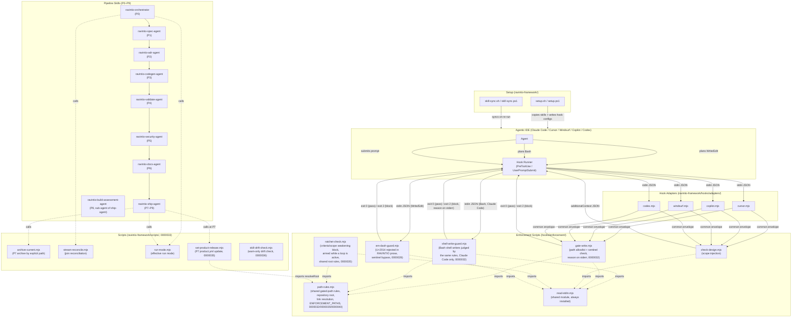

# Architecture Overview

> Living document. Reflects current system state. Updated after every pipeline run.
> Do not archive this file; update it in place.

Last updated: 0000044-credential-scan-word-boundary (11 Nov 2026). The credential scan's `api-secret-key` rule skips `sk-` inside a word, so `release.yml` commits at P7 without a hold-back. The pack moves to 0.39.3. Earlier: 0000043-macos-test-job-timeout (8 Nov 2026). The macOS test job runs as three shards, each matrix entry carries its own cap, and each test job prints its time against that cap. The pack moves to 0.39.2. Earlier: 0000042-fix-windows-shards-pr-77 (8 Nov 2026). Two 0000041 suites pass on the Windows shards, and the pack moves to 0.39.1. Earlier: 0000041-pack-source-under-src (7 Nov 2026). The pack source lives at `src/ravintio-framework/`, and the root `ravintio-framework/` is a release copy with a `release.yml` and no `component.yml`. Earlier: 0000040-retire-fast-path (7 Nov 2026). Every change now runs the Feature Pipeline, and pre-push and CI apply a source folder rule read from `product.yml`. Earlier: 0000039-ravintio-rebrand (25 Oct 2026). The pack, the overrides folder, and every skill now carry the RAVINTIO name, with a consumer migration and a brand guard. Earlier: 0000038-token-efficiency-windows-shard (24 Oct 2026)

---

## System Summary

RAVINTIO Framework is a CLI tooling framework that enforces a structured design pipeline for agentic coding agents. It installs enforcement hooks into agentic IDEs (Claude Code, Cursor, Windsurf, GitHub Copilot, Codex) that gate writes to `src/` behind a confirmed design document, and provides a suite of pipeline skills (spec, ADR, codegen, validate, security, docs, ship) that guide development from brief to merged PR.

---

## Components

| Component | Type | Purpose | Status |
|-----------|------|---------|--------|
| `setup-hook-integration` | component-pack | setup.sh/ps1 and skill-sync: installs enforcement hooks, commit standards, external skill management, and (0000020) a per-tool flags-used marker into any RAVINTIO-managed project | active |
| `ravintio-refresh-setup` | skill (standalone, not a src/ component) | Detects a RAVINTIO install's target tool, reconstructs the setup flags in effect from the flags-used marker or hook wiring, confirms with the human on the loop, and safely re-invokes setup.sh/setup.ps1; see `ravintio-framework/skills/ravintio-refresh-setup/SKILL.md` | active |

---

## Communication Patterns

---

## Governance Loops (0000016)

The pipeline has an optional loop layer, entirely toggle-gated via `ravintio-overrides/loop-toggles.yml`. An absent file or key turns a loop off, with one exception. Outside `autonomous`, an absent `design_critic` key or an absent file reads as `report-only` (0000036 ADR-009):

| Loop | Seam | Verifier | Deterministic guard |
|------|------|----------|--------------------|
| P0 completeness | P0 exit | Gate checklist re-evaluated per coaching round | 2-rounds-per-gap escalation |
| Design critic | End of P1/P2 | Fresh-context `ravintio-design-critic` (REJECT-default) + `scripts/consistency-check.mjs` | Cap 3, no-progress halt |
| Governed reversal | P3–P6 blocked by upstream P0–P6 artifact | Fresh-context `ravintio-reversal-assessor` (DENY-default) | Budget 2/feature, cascade >3 human gate, ratchet-check.mjs on writes |
| Verify-by-execution | P4 after CI | `ravintio-verify-by-execution` (runs the software) | Feeds existing P4 cap-5 loop |
| Cross-model review | End of P6, strictly pre-P7-archive | Fresh-context reviewer on a different model id (REJECT-default) | Cap 3; blocks P7 on cap-without-approval |

Shared mechanics (state file, append-only run log, stop rules, escalation format) live in `ravintio-loop-runner`. P7 remains the lock line: no loop or reversal touches archived state (`plan/backlog/` is the governed home for deferred work instead).

---

## Shared hook modules (0000028)

Hook files import their shared helper by relative path instead of carrying their own copy. `read-stdin.mjs` lives in `hooks/enforcement/`, which installs unconditionally, so every hook that imports it finds it on every install. A helper with an always-installed caller belongs in that tree. The reverse placement would leave an always-installed hook importing an absent module, which fails at ESM module-load time before the hook's own `try/catch` runs and so defeats the exit-zero invariant.

Self-modification sequencing (ADR-004) governs how such a change is applied to hooks that are executing the build doing the editing. Rewire one caller, commit, re-run `setup.sh` for that edit alone, then assert a real side effect. Exit 0 proves nothing here by design.

---

## Continuous integration (0000031)

`.github/workflows/ravintio.yml` runs five jobs on every pull request to `main`.

| Job | Runner | What it checks |
|-----|--------|----------------|
| `validate-branch` | `ubuntu-latest` | A change to a source folder also touches a file under `plan/` or `docs/`. A source folder is `src/` or the folder of a `component.yml` that `product.yml` lists (0000040 ADR-003) |
| `self-description-check` | `ubuntu-latest` | The README matches the repository structure (0000019) |
| `test-suite` | `ubuntu-latest` in one job, `macos-latest` in three shards, and `windows-latest` under Git Bash in seven shards, `fail-fast: false` (0000043 ADR-002) | `run-tests.sh` passes within the entry's `cap`. On failure, the log lists each failed suite by file name. Each job then prints its elapsed time against its cap (0000043 ADR-003). |
| `setup-powershell` | `windows-latest`, PowerShell 7 | `test_setup.ps1` passes, including the live `.ravintio-setup-flags` marker checks |
| `setup-powershell-51` | `windows-latest`, Windows PowerShell 5.1 | `test_setup.ps1` passes under 5.1, including the live stale clean-up and retired-flag checks (0000037). The 0.37.0 migration helper parses under 5.1, and the req-006 suite's `.ps1` cases pass on `powershell.exe` (0000039) |

These three test jobs are repository-only (0000031-ADR-002). The consumer copy at `ravintio-framework/hooks/ravintio.yml` doesn't carry them. Each declares `permissions: contents: read`, no secrets, and the `pull_request` trigger (0000031-ADR-003).

Feature 0000037 changed the platform matrix (ADR-012, ADR-013, and ADR-014 of that feature):

- Windows PowerShell 5.1 is a supported runtime for `setup.ps1`, tested by `setup-powershell-51`.
- The suite runs on Windows under Git Bash. `run-tests.sh` reads `RAVINTIO_SHARD_INDEX` and `RAVINTIO_SHARD_COUNT`, so the Windows leg runs in seven shards.
- Each Windows shard has `timeout-minutes: 20`. Every other job keeps 10.
- Feature 0000039 gives the Linux and macOS legs of `test-suite` 15 minutes. The macOS leg passed every suite but ran past 10 minutes once the migration helper suite grew. No ADR records this change. The 0000031 and 0000037 CI checks expect the new value.
- Feature 0000043 moves each `test-suite` cap into the matrix (0000043 ADR-002, which amends 0000037 ADR 014). The bullets above give the caps before that change.
  - Every entry sits under `include` with a `cap`: 15 for Ubuntu and macOS, and 20 for Windows. Sharded entries also carry `shard` and `shards`.
  - macOS runs in three shards, and `RAVINTIO_SHARD_COUNT` reads `matrix.shards`. Two shards ran past 10 minutes in two PR #77 runs, so P4 added a third, as ADR-002 sets out.
  - The test step's `timeout-minutes` reads `matrix.cap`. The job has a fixed 25-minute backstop, so a slow suite fails the step and the job's later steps still run.
  - A step records the start time in `GITHUB_ENV`. An `if: always()` step prints `Elapsed: {m} min {s} s of a {cap} min cap`, and adds a `Test job margin` warning past two-thirds of the cap (0000043 ADR-003).
- A suite check that can't run on Windows prints `SKIP (windows): {reason}` and has a row in the skip table in `ravintio-framework/tests/README.md`.

A red check doesn't block a merge until branch protection marks it as required. Only the human on the loop can change that setting.

---

## Run lifecycle and write gate scope (0000032)

### Session markers and close-out

The orchestrator writes three committed session markers at P0:

- `plan/.orchestrator-active`
- `plan/.orchestrator-ack`
- `plan/.run-mode`

Since 0000032-ADR-002, P7 no longer touches them. A new P9 step, "Clear session markers", runs after P8 and before the Step 9 tag. It stages the archive, deletes the markers, and commits both together. It then runs `git ls-files` on the three paths and stops before the tag if any path is still tracked. Hooks therefore treat P8 and P9 as part of the run, and the tag never carries a marker.

Resume Detection in the orchestrator reads archive evidence to finish an interrupted close-out:

- Step 2a fires when the sentinel is present and `plan/current/` is empty. With no `build-report.md` in the matching archive, it resumes at P8. With one, it resumes at the P9 marker step.
- Step 2b fires when the sentinel is gone from disk but still committed. It applies the same archive rule.
- If no archive matches, or the sentinel ID fails its format check, either step stops and asks the human on the loop. Neither step deletes a marker or starts fresh.

### Blocking context clear after P9

Ship Step 12 asks the human on the loop to run `/clear` or start a new session (0000032-ADR-003). The orchestrator refuses new work in the same session until that happens. In the next session, `auto-trigger-orchestrator.mjs` says no RAVINTIO run is active, and the agent must triage the request before it acts. The handover-route rule (ship agent Hard Limit 6) makes every P9 handover note route each next step through the Feature Pipeline, or the standalone skill it needs (0000040 ADR-002).

### Shared path rules and repository root

`hooks/enforcement/path-rules.mjs` holds every gated-path rule (0000032-ADR-004). `gate-write.mjs` and `shell-write-guard.mjs` import it, so the two gates can't disagree about a path. It sits in `hooks/enforcement/`, so every install that copies `gate-write.mjs` copies it too.

The module finds the repository root with a marker walk that spawns no process:

1. It walks up from `CLAUDE_PROJECT_DIR`, then from `cwd`, and takes the first walk that finds a marker.
2. In each walk, the nearest folder holding `ravintio-framework/` wins. Failing that, the nearest folder holding `.git` wins.
3. A marked folder inside `plan/` or `docs/` of a higher marked folder is never the root.
4. With no marker found, the root is `cwd`.

Feature 0000035 hardens these rules. The section on [write gate path hardening](#write-gate-path-hardening-0000035) describes the changes.

The module looks up the sentinel and `plan/current/design.md` from the root. A target outside the root passes with no output. A target too long to judge, over 4096 characters or 256 segments, passes with a warning on stderr.

### Block reasons on stderr

Every enforcement hook that exits 2 writes a plain-text reason to stderr, where Claude Code reads it (0000032-ADR-005). The covered hooks are `gate-write.mjs`, `ratchet-check.mjs`, `em-dash-guard.mjs`, and `shell-write-guard.mjs`. The existing hooks keep their stdout byte for byte, so the Windsurf, Copilot, and Codex adapters still relay it.

### Bash shell-write guard

`shell-write-guard.mjs` runs on Claude Code's Bash PreToolUse event (0000032-ADR-006). It finds common shell writers:

- redirects
- `tee`
- `sed -i` and `perl -i`
- the destination of `cp`, `mv`, `install`, and `ln`
- every argument of `rm`, `touch`, and `mkdir`

It judges each target with `resolveTarget` and `evaluateWrite` from `path-rules.mjs`. It tracks the folders each command may run in after `cd`, `pushd`, and `popd`, and judges a relative target against each one. If it can't parse a command or a target, it writes a warning to stderr and allows it. It ignores `git` and can't see writes made inside scripts or interpreters. A boot-file Hard Limit in `standard-boot.md` and `cursor-boot.md` covers those gaps: code changes go through **Write** or **Edit**, never Bash.

`setup.sh` and `setup.ps1` register the guard on a `Bash` PreToolUse matcher for Claude Code only. Each removes any earlier `shell-write-guard` group before it adds one, so a re-run leaves exactly one. Other tools rely on the boot-file rule alone. The 0.31.0 migration tells downstream projects to re-run setup.

---

## Run modes and autonomous runs (0000033)

`plan/.run-mode` now holds one of three values: `interactive`, `continuous`, or `autonomous`. An unknown value reads as `interactive`, so an older framework treats `autonomous` as `interactive` (0000033-ADR-002). `scripts/run-mode.mjs` prints the effective mode for every reader after P0. It prints `autonomous` only when git history anchors the confirmation. Otherwise it prints `interactive` and gives the reason on stderr.

### Exception list and standing rules

In `autonomous`, the run stops for the human on the loop only on a declared exception list (0000033-ADR-003). The standing rules live in `standards/autonomous-run-standards.md`.

- Schema and destructive changes.
- A gross deviation, meaning a change the reversal protocol would class as altering the confirmed problem, users, or scope.
- Human review of the running result.
- Promotion beyond the candidate environment.
- A human-only input.
- An exhausted budget.

A product adds items through `ravintio-overrides/` using `templates/exception-list.template.yml`. Merging pull requests stays human-only in every mode. The ship agent ships without asking and ends P9 with one final report.

### Gates as loops

In `autonomous`, every phase gate runs as a loop under `ravintio-loop-runner` with a fresh-context checker (0000033-ADR-004). Existing caps stay. At a cap, the run tries a different approach, up to 3 approaches per loop instance (0000033-ADR-005). The fourth becomes an exception. The reversal budget stays at 2 per feature. Each phase writes a one-line progress entry to the build log, and the P8 report flags the human-touchpoint count.

### P0 questions and release sizing

`standards/p0-question-policy.md` limits P0 to real forks (0000033-ADR-007). Adoption mode, version, stack, and similar items go into the design draft for one confirmation. The design, the Scope Lock batch, and the run mode confirm in one turn. The build log records the question count. When a design depends on existing records, discovery samples recent rows and the design states the usable rate as an assumption. `standards/release-sizing.md` sizes each requirement as small (1), medium (2), or large (3). P0 fills the release from the backlog up to the target in `ravintio-overrides/release-budget.yml` (0000033-ADR-008). Without that file, the three-story rule applies.

### Parallel streams and join reconciliation

Parallel dispatch is the default in every phase (`standards/agent-dispatch-standards.md`). Independent requirements move through P1 to P4 as separate streams. Each stream has a state file under `plan/current/streams/`, from `templates/stream-state.template.md`. The `parallel_streams` toggle in `loop-toggles.yml` defaults to `on` in `autonomous` and `off` otherwise (0000033-ADR-013). The orchestrator owns every join. After each join, `scripts/stream-reconcile.mjs` checks that every artifact one stream declares is consumed by another stream or by a requirement (0000033-ADR-014).

### Close-out and scripts

`scripts/archive-current.mjs` runs the P7 archive (0000033-ADR-010). It moves each tracked item with `git mv`, removes markers by explicit path, and prints what it moved. Each step is a separate command, so a resumed run repeats only unfinished steps. It never uses a glob delete. The P8 build report goes into the archive commit, which is the 0000032 marker-step commit (0000033-ADR-011). P8 and P9 end with a scoped `git status --porcelain` check. In `autonomous`, the run commits any leftover file. In other modes, the P9 gate summary lists leftovers and asks. After P6, the docs agent reruns the P4 check set, or a smaller command declared in `templates/doc-checks.template.yml` (0000033-ADR-012). Every two-option prompt names the actor in each option.

---

## Write gate path hardening (0000035)

### Real targets, two ways

`path-rules.mjs` now judges where a write lands, not the text of the path (0000035-ADR-005). `resolveTarget` walks the target one segment at a time through symbolic links. A `..` moves to the real parent of the path resolved so far. The walk follows at most 40 links.

The **Write** and **Edit** tools collapse `..` as text before the system follows links, so the two methods can land on different files. `resolveTargetBoth` returns both placements:

- the physical placement, which matches how the kernel resolves a shell path
- the text placement, with `..` collapsed against `cwd` first

`gate-write.mjs` and `ratchet-check.mjs` judge both placements and block if either one blocks. `shell-write-guard.mjs` keeps the physical walk only.

A link loop, a chain past 40 links, or a resolution error blocks with exit 2 when the path lies inside the root. Errors outside path resolution still fail open (0000003-ADR-005).

### Root lookup without a cwd

`resolveRoot` no longer needs the working folder to exist (0000035-ADR-006). It checks `CLAUDE_PROJECT_DIR` first. It then walks up from the nearest existing parent of `cwd`. Each hook takes the stdin `cwd`, then `process.cwd()`, then `CLAUDE_PROJECT_DIR`.

### Planted markers

`markedRoot` distrusts a `.git` or `ravintio-framework` marker that sits below an always-permitted name, such as `plan/w/.git` (0000035-ADR-008). The walk goes on to the next trusted marker above, so a moved folder can't become a new root.

### `ENFORCEMENT_PATHS`

`path-rules.mjs` exports a frozen list, `ENFORCEMENT_PATHS` (0000040 ADR-004). It covers hook folders, hook wiring, tool-local settings, setup scripts, the CI workflow, and `.git/`. `isEnforcementPath` matches a path against it. The match folds case and NFKC lookalikes, and it reads a `**/` entry at any depth.

The list has one caller, `isAlwaysPermitted`. An always-permitted name such as `CLAUDE.md` inside a listed path gets no shortcut, so it takes the normal route (0000036-ADR-003). With no design, that write blocks. With a design, the component-path check judges it.

### ratchet-check shares the root rules

`ratchet-check.mjs` imports `resolveRoot` and `resolveTargetBoth` from `path-rules.mjs` (0000035-ADR-007). It finds `plan/current/` from any subfolder. It passes an unresolvable target, because `gate-write.mjs` already blocks it.

### product.yml at P7

The ship agent sets `product.yml` `version` and `feature` in P7, after Step 5 and before Step 6 archives `design.md` (0000035-ADR-010). It runs `scripts/set-product-release.mjs`, which applies each `versionPolicy`. The script exits 0, 2, 4, or 5. It writes only `{root}/product.yml`, through a temp file and a rename. It imports `resolveRoot` from `path-rules.mjs` and clears `CLAUDE_PROJECT_DIR` for that call.

### Sanctioned scripts: the Write-or-Edit rule (boot Hard Limit 8)

The Write-or-Edit rule (boot Hard Limit 8) now names the fixed framework scripts that skill steps run to write files (0000035-ADR-011). Both `standard-boot.md` and `cursor-boot.md` carry one `Sanctioned scripts:` sentence. It names eight scripts:

- `archive-current.mjs`
- `set-product-release.mjs`
- `build-release.mjs` (0000041 ADR-003), with no arguments
- `promote-to-regression.sh`
- `refresh-delete-boot-files.sh` and `refresh-delete-boot-files.ps1`
- `setup.sh` and `setup.ps1`

Each script counts only with the arguments its skill step shows. No other script counts.

### Migration run state

Migration files never move (0000035-ADR-015). Every migration sits at the top level of `ravintio-framework/migrations/`, and the old completed-migrations folder is gone. Each project records each run at `plan/_migrations/{stem}.md` (0000035-ADR-016). A record holds one outcome: `applied`, `not applicable`, or `skipped`.

A migration is pending when its record is missing or can't be read (0000035-ADR-018). Orchestrator resume detection reads the records, and the migrator is their only writer (0000035-ADR-017). Each record comes from a scan, never from seeding (0000035-ADR-019).

### Acceptance-criteria limit

`consistency-check.mjs` allows up to 10 acceptance criteria per requirement (0000035-ADR-012). From 4 to 10 it prints a warning and exits 0.

---

## Pipeline friction and gate fixes (0000036)

This release adds no language, runtime, or library (0000036-ADR-001). The new gate rules sit in `path-rules.mjs` on `node:fs` and `node:path`. The changed hooks start no new process. `ratchet-check.mjs` keeps its one `git` spawn.

### Skill drift check

`scripts/skill-drift-check.mjs` compares each source `SKILL.md` with the active tool's installed copy (0000036-ADR-005). It applies setup's four path rewrites to the source text and strips one leading byte order mark from each side. It reads the setup marker to find the active tool. If no marker is valid, it checks every installed skills folder it finds.

The script uses Node built-ins, starts no process, and never writes. It never follows a link. It exits 0 when every copy matches, 1 when a copy is stale or missing or nothing is installed, and 2 when it can't compare.

The orchestrator runs it in Resume Detection step 1b, after the framework update check in step 1a. On exit 1, the orchestrator names each stale or missing skill to the human on the loop and recommends `ravintio-refresh-setup`. It never runs setup itself. It loads source copies of the stale skills only after step 1a found no update or the human on the loop confirmed the update.

### Setup-delivered files and the 0.34.0 migration

A setup-delivered file is one that `setup.sh` or `setup.ps1` copies into a tool folder or writes into a boot file or settings file (0000036-ADR-006). The definition follows what setup copies, including its copy-all fallback for templates and standards. Git hooks are not setup-delivered, because git runs them in place. `standards/framework-update-policy.md` states that a release that changes one ships a re-run-setup migration.

`migrate-0.34.0-rerun-setup.md` covers 0.33.0 and 0.34.0, because 0.33.0 shipped none. Its `**Target:**` line names every project with an installed setup, the framework source included (0000036-ADR-007). This departs from the 0.31.0 migration, which names downstream projects only. At the end of P6, the agent repeats the diff check and re-runs setup here. Only then does it write the `applied` record in `plan/_migrations/`.

### Write gate: design.md read rules

`evaluateWrite` calls `lstatSync` on `plan/current/design.md` before it opens or reads the file (0000036-ADR-002). This narrows the exit-zero failure mode (0000003-ADR-005) for this one step.

| Outcome | Gate reading |
|---------|--------------|
| `ENOENT` or `ENOTDIR` | No design. `scopeVerdict` judges the write. |
| Regular file | The gate opens, checks, and reads it. |
| Any other type, including a folder, FIFO, or link | No design, and each block adds a "not a regular file" line. |
| Any other `lstatSync` error | No design, with no extra line. |

For a regular file, the gate opens it once with `O_RDONLY`, `O_NONBLOCK`, and `O_NOFOLLOW` where the platform defines them. It then calls `fstatSync` on the descriptor. A file swapped after `lstatSync` reads as non-regular. A regular file over 1 MiB reads as no design, and the gate reads no more than the size `fstatSync` reported.

Only `EACCES` and `EPERM` from the open or `fstatSync` fail open. Every other error blocks, so a code the gate doesn't know can't pass a write. The kept `chmod 000` bypass stays under the exit-zero rule and has a backlog entry.

### Always-permitted names inside enforcement paths

The always-permitted file-name shortcut applies only when `isEnforcementPath(relPath)` is false (0000036-ADR-003). A permitted name inside an enforcement path, such as a `CLAUDE.md` below a hook folder, goes on to the `design.md` step. The gate keeps one path list. The `plan/` and `docs/` prefix shortcut and the sentinel step are unchanged.

### Escaped hook output

`shown(p, max)` in `path-rules.mjs` builds its output from whole units, where a unit is one escape sequence or one unescaped code point (0000036-ADR-004). The cut never ends inside an escape or a surrogate pair. `shell-write-guard.mjs`, `ratchet-check.mjs`, and `em-dash-guard.mjs` import it. `gate-write.mjs` reaches it through `judgeWrite`. `ratchet-check.mjs` and `em-dash-guard.mjs` quote their targets at a cap of 200. `skill-drift-check.mjs` also imports it.

### Run-mode anchor

`run-mode.mjs` accepts the anchor as a whole line, either bare or as one `- ` list item (0000036-ADR-008). The timestamp must be a real UTC time. Leading spaces, other list markers, and trailing text all count as no anchor. The working-tree check counts both forms together and needs exactly one line. The one-commit rule, the removal rule, and the read cap are unchanged.

### Design critic default

Outside `autonomous`, an absent `design_critic` key or an absent `loop-toggles.yml` reads as `report-only` (0000036-ADR-009). The orchestrator spawns the critic at the P1 and P2 gates and shows the verdict with the gate summary. The verdict blocks nothing. The Governance Loops table above records this default.

### Split step

Before an agent adds a fourth acceptance criterion to a requirement, it asks whether the requirement holds two concerns (0000036-ADR-011). The spec agent, the design critic rubric, and the loop runner fix dispatch all carry the step. A split adds a new requirement file and moves no existing criterion line. A deferred move waits until no loop is active.

### Hard-limit citations and commit subjects

Every hard-limit citation reads `the {name} rule ({source} Hard Limit {N})` (0000036-ADR-010). A suite fails on a bare citation. Commit subject templates hold no placeholders, and the feature ID moves to a second `-m` message (0000036-ADR-012).

---

## Green CI before ship (0000037)

Feature 0000037 makes a red check visible before the human on the loop merges. The CI jobs and platform matrix sit in the Continuous integration section above.

### Credential scan and scan-then-commit

`scripts/credential-scan.mjs` is the one home for the credential rules (0000037-ADR-003). It applies the P8 refused file names and patterns, and also runs `gitleaks` when it is on PATH. It scans each path's index blob and its working-tree file. It exits 0 for clean, 1 for a match, and 2 when it could not run. It prints a path and line number and never the matched text. It never stops a commit. The agent does, under a standing rule in `standards/autonomous-run-standards.md`.

In `autonomous`, every commit in P7 to P9 follows scan-then-commit. The `--safe-paths` mode writes only the clean paths to a NUL-separated file. The commit names that file with `--pathspec-from-file`. A matched file is held back, logged as `Credential scan (P{N}): held back {path}`, and raised as exception item 7. A resumed run reads those lines and never stages a held-back path until the human on the loop clears it.

Ship writes the PR title and body to files, scans each with `--file`, and sends them with `--body-file` (0000037-ADR-004). PR text cites paths and IDs and never holds pasted output.

### P9 CI check and draft-PR reuse

P9 gains Step 10c (0000037-ADR-002). It runs `gh pr checks {n} --json name,bucket,link` every 30 seconds for 20 minutes, or 30 minutes while the Windows 20-minute cap applies. It judges from the JSON and never from the exit status. `cancel`, a timed-out check, an empty list, and any unmapped bucket read as unknown, never as a pass. In `autonomous`, a red check gets up to 3 fix attempts on the feature branch. Each attempt commits under scan-then-commit and pushes without force. After the third failure, the agent writes `Exception waiting (P9, 6)` and runs `gh pr ready --undo`. Any result other than all passed writes `Progress: P9 blocked`.

Step 10 first looks for an open PR with `gh pr view --json number,url,isDraft,state`. If the P3 draft PR exists and its `state` is `OPEN`, Step 10 updates it with `gh pr edit --body-file` and never raises a second. A resumed P9 reads `PR: #{n}` from the archived build log.

### GUTD step 5

`ravintio-overrides/instructions/custom-003-git-up-to-date-shorthand.md` gains step 5 (0000037-ADR-005). After the untracked-files report, it reads the checks of the newest merged PR into `main` and reports them as "the last merged PR's checks". It is read-only and does not wait. It never says "main is green". The workflow trigger stays `pull_request`.

### Post-P6 revalidation

The docs agent revalidates after the P6 commit and before it reports P6 complete (0000037-ADR-006). It runs the `command` from `ravintio-overrides/doc-checks.yml` when valid, else P4 steps 0 to 5. It writes one `Revalidation (P6): {command | P4 steps 0-5}, {pass | fail | skipped, no P6 edits}` line. In `autonomous`, the revalidation runs as a loop with a cap of 3 cycles. It then tries up to 3 approaches before it becomes exception item 6. Outside `autonomous`, the cap stays at 5 with the `VALIDATION BLOCKED` escalation.

### Verified by field and P3 scan

Each acceptance criterion carries `Verified by` with one of six types: `unit`, `integration`, `contract`, `e2e`, `execution`, or `manual` (0000037-ADR-007). An indented `Verified by:` line governs over inline text. A requirement file without the field stays valid and reads as `unspecified`. Before P3 closes, the codegen agent maps each requirement ID to a test. It also checks the declared type against the `# Verified by: {type}` header comment of the mapped suite (0000037-ADR-008). `execution` and `manual` are deferred to P4. The P4 coverage table gains a `Type` column.

### Portability lint

A lint suite flags tool use that differs between GNU and BSD systems, such as `grep -r` without `-H` and bare `shasum` (0000037-ADR-011). A rule matches only in command position. A `# portable-ok: {reason}` marker silences one line. `helpers/assert.sh` gains `sha256_of`, which tries `sha256sum` and falls back to `shasum -a 256`. Two further suites test the installed hook commands verbatim through `bash -c` (0000037-ADR-009). They also compare the re-run-setup migration's file list with the diff since the previous `v*` tag (0000037-ADR-010).

---

## Token efficiency and Windows shard (0000038)

Feature 0000038 cuts the tokens each run reads and fixes a flaky Windows timing check. The framework stays on the same stack (0000038-ADR-001).

### Orchestrator reference files

Phase 0 and Adoption Modes moved out of `skills/ravintio-orchestrator/SKILL.md` into two files in `skills/ravintio-orchestrator/references/` (0000038-ADR-002):

- `phase-0-assess-and-coach.md`
- `adoption-modes.md`

`SKILL.md` keeps one pointer section. At the start of P0, the orchestrator reads both files and logs `P0 references loaded: {paths}`. Resume Detection reads them again when the run is still at P0. A run past P0 reloads only the `### Capability Skills` section of the Phase 0 file, at each phase transition. Setup copies `references/` with the skill. In a skill's own reference files, setup rewrites only `../standards/` links. In `SKILL.md`, it also rewrites `../templates/` and `../schemas/`. Both setup scripts read the files as UTF-8 and write them without a BOM.

### Model tiers for Claude Code

The Claude Code tiers are the aliases `sonnet` (primary) and `haiku` (cheaper). The allowed set is `sonnet`, `opus`, `haiku`, and `fable` (0000038-ADR-003). A test fails on any other value in the tier table, the dispatch skeleton, the skills, or `pipeline-reference.md`.

### Quiet test runner

`tests/run-tests.sh --quiet` prints only the failed suites and the totals (0000038-ADR-004). A suite fails on a non-zero exit code or a `FAIL:` line. The refactor, validate, and codegen skills use quiet mode.

### Dispatch size floor and partial reads

`custom-002` and the dispatch standard set a size floor (0000038-ADR-006). A small independent unit runs as a parallel tool call in the main thread. Nine roles stay exempt, such as the design critic and the test-writer. The boot template tells the agent to read only part of a file over about 20 KB.

### Timing checks

Each timing check makes one untimed warm-up call and one timed call under 200 ms, with no retry (0000038-ADR-005).

### Migration

`migrate-0.36.0-rerun-setup.md` tells projects to re-run setup, because the changed files reach a project only through setup (0000038-ADR-007).

---

## RAVINTIO rebrand (0000039)

Release 0.37.0 renames the pack to `ravintio-framework/` and the overrides folder to `ravintio-overrides/`. Every skill takes a `ravintio-*` name. Prose writes RAVINTIO, paths and ids write `ravintio`, and environment variables use the `RAVINTIO_` prefix (0000039-ADR-002). The release is a minor bump from 0.36.0 (0000039-ADR-003). One scripted pass did the rename and kept history byte-identical (0000039-ADR-008, ADR-009).

### Consumer migration

`migrate-0.37.0-ravintio-rename.md` ships with the helpers `migrate-0.37.0-ravintio-rename.sh` and `.ps1`, which behave the same (0000039-ADR-005). The consumer copies the new pack in, runs the helper from the project root, and then runs setup. The helper moves the overrides folder and the workflow file. It stops git tracking of the old pack and moves it into `.ravintio-backup/` with a plain rename. It deletes nothing, and a rerun is safe. Setup stops while the old pack or the old overrides folder exists.

The migrator maps old pack, overrides, and skill names to the new ones when it runs an older migration, and it never edits a shipped file (0000039-ADR-006). It reads an `**Applies when:**` line near the top of a migration. If the condition is false, it skips the migration and records `not applicable`. This source repo and a fresh consumer take that path, so the rename migration never shows as pending there. The orchestrator reports every skipped migration.

### Old-name reads

Through the 0.x line, the pack still reads the old session ID variable and the old boot-file markers and ignore-file headers (0000039-ADR-004). Setup replaces each old block with the RAVINTIO form. Setup reads neither the old setup flags file nor the old manifest file. The migration helper renames both in each of the eight tool folders, with the flags content unchanged. It also renames each old skill folder the manifest lists and rewrites the entries. It keeps an entry only when its name passes a strict allowlist and its parent is the real skills folder (0000039-ADR-005). The helper's next-step message prints the setup command with the saved flags. Setup stops while either old marker file exists, and names the migration. `setup.sh` writes real manifest paths, as `setup.ps1` does. The old session marker is not read. Version 1.0.0 removes every old-name read (0000039-ADR-003). The `ravintio-framework` component owns the new marker files (0000039-ADR-010).

### Brand guard

`test-0000039-req-007-brand-guard.sh` reads `git ls-files` and fails on any match of the old brand name in a path or line (0000039-ADR-007). It skips history paths. An allowlist entry must match both path and line, and a stale entry fails the suite.

---

## One track and the source folder rule (0000040)

Release 0.38.0 retires Fast Path and the Change Pipeline, so every change runs the Feature Pipeline (0000040 ADR-002). The declared stack stays unchanged (0000040 ADR-001).

### One track

The Routing Directive in the orchestrator keeps its triage step, with two outcomes (0000040 ADR-002). A request that meets a standalone skill trigger invokes that skill. The standalone skills are `ravintio-optimise-agent`, `ravintio-refresh-setup`, and the retrofit workflow. Every other request goes to the Feature Pipeline, whether or not it has a `src/` target. The version bump table keeps the minor and major rules and drops the patch rule for the retired tracks.

The pack no longer ships `workflows/fast-path.md`, `workflows/change-pipeline.md`, or the `ravintio-change-agent` skill. The `PC:` prefix goes with them (0000040 ADR-002).

### Write gates

`gate-write`, `shell-write-guard`, and `ratchet-check` no longer read `plan/.fast-path-scope` (0000040 ADR-002). `path-rules.mjs` drops `scopeVerdict` and `readGitState` with it. With no design, `gate-write` blocks every write outside `plan/`, `docs/`, and the always-permitted names. The enforcement path list stays as `ENFORCEMENT_PATHS`, described above (0000040 ADR-004).

### Source folder rule in pre-push and CI

`hooks/pre-push`, the consumer template `hooks/ravintio.yml`, and this repo's `.github/workflows/ravintio.yml` drop the `fix(fast-path):` commit subject exemption (0000040 ADR-003). In its place they apply one source folder rule:

- A source folder is `src/`, or the folder of a `component.yml` that `product.yml` lists.
- If a diff touches a source folder, the same diff needs a file under `plan/` or `docs/`.
- A `component.yml` counts as source, not as a record.

The rule reads `product.yml` with `git show` at the base commit and at `HEAD`, never from a folder scan. If `product.yml` is absent or can't be read, the rule checks `src/` only and prints a warning. Pre-push fails closed when a shallow clone has no merge base.

### Setup retired list

Setup carries a named retired list that doesn't depend on the skill manifest (0000040 ADR-005). `setup.sh` holds `RETIRED_TRACK_WORKFLOWS` and `RETIRED_TRACK_SKILLS`, and `setup.ps1` holds `$RetiredTrackWorkflows` and `$RetiredTrackSkills`. Every run removes those installed workflow copies and skill folders from the tool it sets up.

### Consumer migration and migrator named paths

`migrate-0.38.0-retire-fast-path-and-change-pipeline.md` asks the human on the loop to delete a leftover scope record, then checks that it is gone (0000040 ADR-006). It warns on an unfinished run of a retired track and asks for a setup re-run. It also removes the exemption block from the consumer's `.github/workflows/ravintio.yml` once the human on the loop confirms.

The scope rule (migrator Hard Limit 1) now lets a migration list extra paths on a `**May edit:**` line (0000040 ADR-006). The human on the loop confirms each edit to a named path on its own, in every run mode. The migrator refuses an absolute path, a `..` part, a link, and any path under `src/`.

In a hooked consumer with no design, `gate-write` blocks the CI edit. The migration then records `skipped` with the reason `blocked`, and names the file and the lines to delete by hand. The human on the loop accepted this outcome at P5 (risk R-014).

### Residue guard

`test-0000040-req-006-residue-guard.sh` fails on any live reference to either retired track (0000040 ADR-007). It skips history prefixes such as `plan/_archive/` and `plan/changelog/`. A closed allowlist and a history-line rule cover the rest, and a stale allowlist entry fails the suite.

---

## Pack source under src (0000041)

Release 0.39.0 moves the pack source to `src/ravintio-framework/` (0000041 ADR-002). The declared stack stays unchanged (0000041 ADR-001). In this repo, `src/ravintio-framework/` holds the source and its `component.yml`. The root `ravintio-framework/` is a copy of the last release. This repo runs on that copy, so a broken change under `src/` can't break the run that builds it. Consumers still copy `ravintio-framework/`, which stays their runtime path.

### Release copy and release script

`scripts/build-release.mjs` rebuilds the root copy from `src/ravintio-framework/` without `component.yml` (0000041 ADR-003). It builds in `.ravintio-framework-build/` and swaps the folders. The old copy waits in `.ravintio-framework-previous/` until the swap succeeds, and an interrupted build leaves the old copy whole. It writes only inside those three folders and refuses a path that resolves outside them. It runs only in the source repo, which `project-kind.mjs` decides. The Write-or-Edit rule (boot Hard Limit 8) sanctions the script, and ship Step 5c runs it at P7. `release-check.mjs` compares the root copy with its `release.yml` and refuses a `release.yml` folder.

### release.yml and update detection

The released pack carries `ravintio-framework/release.yml` with a `version`, a `source-commit`, a `built` date, and a SHA-256 for each file (0000041 ADR-004). Orchestrator step 1a, `standards/framework-update-policy.md`, and the migrator read it first and fall back to `component.yml` for a pack before 0.39.0. Step 1a now has two signals. A new `source-commit` or `version` is a release update. A pack file that differs from its hash is a changed file, even when the version is unchanged, and step 1a names it. This closes backlog 0000181. While a leftover `component.yml` sits beside `release.yml`, step 1a warns at every session start.

### Manifest location

A component manifest lives at the path `product.yml` lists, with `src/{component-id}/component.yml` as the default (0000041 ADR-006). `templates/component-guide.md` owns the rule, and the spec and docs agents link to it. The codegen close-out bumps the manifest of each component the run changed. It never names `ravintio-framework/component.yml`, so a consumer's copy is not bumped as source.

### Applies to header and project kind

A repo is the framework source when `product.yml` lists `ravintio-framework` at `src/ravintio-framework/component.yml` and that file exists (0000041 ADR-007). `project-kind.mjs` prints `framework source` or `downstream`. A migration may carry `**Applies to:**` with `framework source`, `downstream`, or `all`, and an absent line reads as `all`. The migrator records `not applicable` with the reason when the kinds differ. A table in the migrator skill maps the released `retroactive-release-tags.md` to `framework source`. This narrows 0000035 ADR-019 for migrations that carry the header or a table row.

### Consumer migration

`migrate-0.39.0-remove-pack-component-yml.md` applies to `downstream` repos only (0000041 ADR-008). If `ravintio-framework/component.yml` remains beside `release.yml`, it offers to remove the file. The human on the loop confirms and runs the delete, and the migrator checks the result. A decline, a `product.yml` entry for the file, or a linked folder records `skipped` and names the file.

### Tests and CI from src

In the source repo, suites read the pack through `tests/helpers/pack-root.sh`, which gives `src/ravintio-framework/` and fails a suite that reads the root copy (0000041 ADR-009). CI runs `src/ravintio-framework/tests/run-tests.sh`. A new `release-copy-integrity` job runs `release-check.mjs --files-only` against the root copy. It reports a skip while the root copy has no `release.yml`. The job is repo-only and is not part of the consumer `hooks/ravintio.yml`. The 0000039 req-010 version equality checks run only on a released tree, where `plan/current/design.md` is absent. `em-dash-guard.mjs` now also covers prose under `src/ravintio-framework/`.

Release 0.39.1 makes two 0000041 suites pass under Git Bash (0000042). Each one puts its link cases behind one `IS_WIN` guard, because `ln -s` makes a copy there (0000042 ADR-002). The req-005 suite passes paths to Node in Windows form and imports `project-kind.mjs` through a file URL (0000042 ADR-001). It checks the released migration by git blob id, so a CRLF checkout can't fail it (0000042 ADR-003). `test-0000042-req-001-windows-guards.sh` runs both suites under a `uname` stand-in that reports `MINGW64_NT`, so a Mac or Linux run checks the Windows branch. It also runs the req-005 suite under a failing `mktemp` stand-in and checks that the caller's folder survives.

Release 0.39.2 gives the macOS test job margin again (0000043). The single macOS job had timed out at 15 minutes in 3 of 4 PR #77 runs. Two shards took 6.5 to 11 minutes each across four runs, so the job now runs three. `test-0000043-req-001-macos-shards.sh` checks the matrix rows and timeouts. `test-0000043-req-002-job-margin.sh` extracts the elapsed step's `run:` block from the workflow and runs it under a fixed `date` stand-in. The step accepts the start time and cap only as 1 to 10 digits with no leading zero, because Bash reads a leading zero as octal.

Release 0.39.3 narrows the `api-secret-key` rule in `credential-scan.mjs` (0000044). The old rule matched `sk-` inside a word. Two `release.yml` hash lines name the vendored risk requirements analysis skill, so every autonomous P7 held `release.yml` back. The rule now needs a word boundary before `sk-`, or one of these escapes before it: `%XX`, `\n`, `\r`, `\t`, or `\uXXXX` (0000044 ADR-002). So this rule misses a key after an ASCII letter, a digit, or `_`. The human on the loop accepted that trade at P0. The 0000037 credential scan suite and its regression copy add negative and positive cases for each context.

---

## Data Ownership

No components own persistent data. RAVINTIO operates on local filesystem artifacts (plan/ files, skill SKILL.md files) written and read during pipeline execution. No databases. New in 0000016 (all plain markdown/YAML, git-tracked): `plan/backlog/` entries (orchestrator-owned, filed by any phase agent), `product.yml` (ship-agent writes, orchestrator reads), and `plan/current/` loop-state/run-log/defect-report/revision-log artifacts (orchestrator-owned). New in 0000020 (local, gitignored, not version-tracked): `<tool-dir>/.ravintio-setup-flags`, owned by `setup-hook-integration`, written on every successful install and read/updated by `ravintio-refresh-setup`. New in 0000025 (git-tracked, additive to the 0000020 marker, not a replacement): `ravintio-overrides/setup-config/{tool}.md`, one file per AI tool, written by `setup.sh`/`setup.ps1` alongside the existing gitignored marker so the flags in effect at install time are versioned and reviewable, not only locally cached.

Clarified in 0000033: `ravintio-framework` owns `plan/.run-mode`, `plan/current/`, and `plan/current/streams/`. The human on the loop owns `ravintio-overrides/` (exception list, release budget, doc checks), and the framework only reads it (0000033-ADR-015).

New in 0000035 (plain Markdown and text):

- `plan/_migrations/` run records: owned by `ravintio-migrator`, read by orchestrator resume detection, git-tracked, never archived (0000035-ADR-017).
- `product.yml`: the ship agent owns it and writes it only through `set-product-release.mjs`. `product-version.mjs` reads it.

Clarified in 0000032: `ravintio-framework` owns the three committed session markers, `plan/.orchestrator-active`, `plan/.orchestrator-ack`, and `plan/.run-mode`. The orchestrator writes them at P0, and the ship skill deletes them in the P9 marker step. Hooks read them only.

Clarified in 0000040: a consumer repo owns its `.github/workflows/ravintio.yml` and its `plan/` markers. A migration edits the CI file only when its `**May edit:**` line names it and the human on the loop confirms the edit (0000040 ADR-006).

Clarified in 0000041 (0000041 ADR-005): `ravintio-framework` owns every file under `src/ravintio-framework/`. The release script owns the root `ravintio-framework/` copy and the two work folders `.ravintio-framework-build/` and `.ravintio-framework-previous/`, and no agent writes the root copy with **Write** or **Edit**. A consumer owns its copy of `ravintio-framework/component.yml`, and the 0.39.0 migration removes it only on confirmation. `setup-hook-integration` owns no pack file.

---

## External Dependencies

| Dependency | Type | Components That Use It |
|-----------|------|----------------------|
| Node.js (built-ins only: fs, path, child_process, os, url, crypto) | Runtime | All hook adapters, enforcement scripts, and `scripts/` (`crypto` in `set-product-release.mjs` only, 0000035) |
| Bash | Runtime | setup.sh, test scripts, hook install scripts |
| PowerShell 7+ | Runtime | setup.ps1, test_setup.ps1, PowerShell hook scripts |
| GitHub Actions hosted runners | CI | `ubuntu-latest`, `macos-latest`, and `windows-latest` jobs in `.github/workflows/ravintio.yml` (0000031) |
| git (core.hooksPath) | CLI | setup.sh/ps1 (commit-msg hook installation) |

---

## Key Architectural Decisions

Reference `docs/decisions-index.md` for the full ADR list.

- **ADR-001 (0000003):** Three-tier enforcement model: Claude Code (Tier 1a), other IDEs (Tier 1b), instructions-only (Tier 2)
- **ADR-002 (0000003):** Common envelope shape: all adapters normalise to `{ session_id, cwd, tool_input, event }` before delegating
- **ADR-005 (0000003):** Exit-zero failure mode: hooks never block on unexpected errors (NFR-003)
- **ADR-003 (0000011):** Hook adapter architecture: delegating pattern; adapters translate envelopes, enforcement logic lives only in shared scripts
- **ADR-003 (0000018):** discovery.md elevated to Hard Limit status: matches the enforcement pattern of the build-log rule (orchestrator Hard Limit 8)
- **ADR-001 (0000020):** Hardcoded, non-extensible deletion allowlist for the refresh skill, enforced in a dedicated script, not prose alone (P5 security finding)
- **ADR-002 (0000020):** Single marker file (`.ravintio-setup-flags`) serves as both install-time record and refresh retry cache, not two separate files
- **ADR-003 (0000020):** Mandatory human confirmation gate before any refresh action, regardless of flag-reconstruction confidence
- **ADR-004 (0000020):** Tool selection is explicit input to the refresh skill, never silently auto-resolved when multiple installs are present
- **ADR-005 (0000020):** No automatic retry on a failed setup re-invocation; retry is always human-initiated
- **ADR-001 (0000024):** `product.yml` extended to single-component projects as the declared product id home (stable name for versioning and for attributing archived runs): extends, not supersedes, 0000016 ADR-002's versioning-only scope
- **ADR-001 (0000025):** Ship-agent PR footer defaults off; restorable only via a `ravintio-overrides/instructions/` opt-in file
- **ADR-002 (0000025):** `ravintio-overrides/setup-config/{tool}.md` (tracked) is source of truth over the gitignored `.ravintio-setup-flags` marker; reconciled on setup/refresh; `.orchestrator-strict` explicitly out of scope
- **ADR-003 (0000025):** Scope Lock Challenge defaults to always-drafted, batch-presented answers: supersedes **ADR-003 (0000017)**, scoped narrowly against `0000014-ADR-008`'s one-question-at-a-time convention (unchanged everywhere else)
- **ADR-002 (0000028):** Shared hook modules live inside the existing `hooks/enforcement/` tree, which installs unconditionally, never in a new top-level `shared/` directory
- **ADR-003 (0000028):** The em dash guard attaches as a `PreToolUse(Write, Edit)` sibling of `gate-write.mjs`, not a git hook, with a reusable in-content sentinel as the bypass so the exemption is visible in the artifact's own diff
- **ADR-004 (0000028):** Self-modification sequencing: when editing the hooks running the build, rewire one caller at a time and verify a real side effect, because exit 0 cannot distinguish a working hook from a silently broken one
- **ADR-002 (0000030):** The retired hook and MCP integrations are removed from the framework. Setup ignores their flags and a re-run cleans up the old install.
- **ADR-003 (0000030):** Setup still accepts the three retired integration flags. Each prints a one-line notice, is never written to the install marker, and never fails a refresh.
- **ADR-004 (0000030):** The clean-up runs on every setup run. It matches on command path, skips a malformed settings file byte-identical, writes through a temporary file, and always exits 0.
- **ADR-005 (0000030):** `setup-hook-integration` owns removal of the stale state the deleted hooks wrote, including the two `plan/` marker folders.
- **ADR-002 (0000032):** Session markers stay committed and are cleared in a P9 step after P8 and before the tag. An interrupted close-out resumes from archive evidence. Supersedes **ADR-001 (0000015)** and amends **ADR-004 (0000015)**.
- **ADR-003 (0000032):** P9 ends with a blocking context clear, and the next session must triage first. Supersedes **ADR-002 (0000015)**.
- **ADR-004 (0000032):** One module, `path-rules.mjs`, holds the gated-path rules and the repository-root walk. Targets outside the root pass.
- **ADR-005 (0000032):** Every enforcement hook that exits 2 writes its reason to stderr and keeps its existing stdout.
- **ADR-006 (0000032):** A heuristic Bash shell-write guard, registered for Claude Code only, fails open and is backed by a boot-file Hard Limit.
- **ADR-002 (0000033):** `autonomous` is a third `plan/.run-mode` value. Unknown values still read as `interactive`.
- **ADR-003 (0000033):** An autonomous run stops only on a declared exception list. A product can add items in an override.
- **ADR-004 (0000033):** In `autonomous`, every gate runs as a loop with a fresh-context checker.
- **ADR-005 (0000033):** A loop that hits its cap tries up to 3 different approaches before it becomes an exception.
- **ADR-007 (0000033):** P0 asks only real forks and confirms the design, Scope Lock batch, and run mode in one turn.
- **ADR-008 (0000033):** The release budget counts size points, not stories.
- **ADR-009 (0000033):** Fast Path admits a change with no `src/` target. Superseded by 0000040 ADR-002.
- **ADR-010 (0000033):** `archive-current.mjs` replaces the glob delete in the P7 archive.
- **ADR-013 (0000033):** Parallel streams use a `parallel_streams` toggle and per-stream state files.
- **ADR-014 (0000033):** The orchestrator owns joins and runs `stream-reconcile.mjs` after each.
- **ADR-002 (0000035):** A Fast Path scope record at `plan/.fast-path-scope` stands in for `design.md`, with a stderr notice on each admitted write. Superseded by 0000040 ADR-002.
- **ADR-004 (0000035):** A scope record never admits a path in the enforcement path list. Partly superseded by 0000040 ADR-004, which keeps the list as `ENFORCEMENT_PATHS`.
- **ADR-005 (0000035):** The gates resolve links segment by segment and judge both placements. A resolution error inside the root fails closed.
- **ADR-006 (0000035):** The root lookup works when `cwd` no longer exists.
- **ADR-007 (0000035):** `ratchet-check.mjs` uses the shared root and target rules.
- **ADR-008 (0000035):** Root markers under always-permitted names are not trusted.
- **ADR-010 (0000035):** `set-product-release.mjs` sets `product.yml` at P7.
- **ADR-011 (0000035):** The Write-or-Edit rule (boot Hard Limit 8) names seven sanctioned scripts. 0000041 ADR-003 adds an eighth.
- **ADR-015 (0000035):** Migration files never move. Supersedes the archive step of **ADR-005 (0000005)**.
- **ADR-016 (0000035):** Each project records migration runs in `plan/_migrations/`.
- **ADR-002 (0000036):** A non-regular, swapped, or oversize `design.md` reads as no design. Only `EACCES` and `EPERM` fail open. Narrows **ADR-005 (0000003)**.
- **ADR-003 (0000036):** An always-permitted file name gets no shortcut inside an enforcement path.
- **ADR-004 (0000036):** `shown()` cuts at whole units and serves four hook outputs.
- **ADR-005 (0000036):** `skill-drift-check.mjs` is a warn-only script that Resume Detection step 1b runs.
- **ADR-006 (0000036):** A setup-delivered file is whatever setup copies, and a release that changes one ships a re-run-setup migration.
- **ADR-007 (0000036):** The 0.34.0 migration targets the framework source too.
- **ADR-008 (0000036):** The run-mode anchor is a whole line, bare or as one list item.
- **ADR-009 (0000036):** The design critic reads as `report-only` by default outside `autonomous`. Amends **ADR-003 (0000016)** and **ADR-004 (0000033)**.
- **ADR-010 (0000036):** Hard limits are cited by name and source.
- **ADR-011 (0000036):** A split step runs before a fourth acceptance criterion.
- **ADR-012 (0000036):** Commit subjects hold no placeholders.
- **ADR-002 (0000037):** P9 polls the PR's checks, reuses an open PR, and in `autonomous` fixes a red check up to 3 times.
- **ADR-003 (0000037):** One script, `credential-scan.mjs`, holds the credential rules. Skill text enforces the stop.
- **ADR-004 (0000037):** PR text is scanned from files and sent from the same files.
- **ADR-005 (0000037):** GUTD reads the last merged PR's checks and keeps the `pull_request` trigger.
- **ADR-006 (0000037):** Post-P6 revalidation runs after the P6 commit and caps at 3 cycles in `autonomous`.
- **ADR-007 (0000037):** `Verified by` takes six values, and an indented line governs.
- **ADR-012 (0000037):** Windows PowerShell 5.1 is a supported runtime. Amends **ADR-001 (0000031)**.
- **ADR-013 (0000037):** The suite runs on Windows under Git Bash with a fix-or-skip rule. Amends **ADR-001 (0000031)**.
- **ADR-014 (0000037):** The Windows shards get a 20-minute cap. Amends **ADR-003 (0000031)** for those shards.
- **ADR-003 (0000039):** The rename ships as 0.37.0, and 1.0.0 removes the old-name reads.
- **ADR-004 (0000039):** A closed list of old names stays readable through 0.x.
- **ADR-005 (0000039):** The consumer migration moves the old pack to `.ravintio-backup/` and deletes nothing.
- **ADR-006 (0000039):** The migrator maps old paths and skips a migration whose `Applies when:` condition is false.
- **ADR-007 (0000039):** The brand guard allowlist matches on path and line.
- **ADR-002 (0000040):** Every change runs the Feature Pipeline, and triage keeps only the standalone skills. Supersedes **ADR-009 (0000033)**, **ADR-002 (0000035)**, and **ADR-003 (0000035)**. Partly supersedes **ADR-004 (0000014)**.
- **ADR-003 (0000040):** Pre-push and both CI files apply a source folder rule read from `product.yml`.
- **ADR-004 (0000040):** The enforcement path list stays as `ENFORCEMENT_PATHS` for the permitted-name rule. Partly supersedes **ADR-004 (0000035)**.
- **ADR-005 (0000040):** Setup removes the retired track files through a named list.
- **ADR-006 (0000040):** A migration may name extra paths on a `**May edit:**` line, and the human on the loop confirms each edit.
- **ADR-007 (0000040):** A residue guard with a closed allowlist fails on any live reference to a retired track.

---

*Template: architecture-overview.template.md*
