# Dependency Graph

**Last updated:** 0000041-pack-source-under-src (7 Nov 2026). Feature 0000041 moved the `ravintio-framework` source to `src/ravintio-framework/` (0.39.0) and changed no component dependency. Three new scripts, `build-release.mjs`, `release-check.mjs`, and `project-kind.mjs`, sit inside the pack. `setup-hook-integration` is 0.8.0, with its code under `src/ravintio-framework/`. Earlier: 0000040-retire-fast-path (7 Nov 2026). Feature 0000040 moved `ravintio-framework` to 0.38.0 and changed no component dependency. Pre-push and CI now read `product.yml` through `git`, and the migrator may edit a consumer CI file it names. Earlier: 0000039-ravintio-rebrand (25 Oct 2026). Feature 0000039 renamed the pack to `ravintio-framework` (0.37.0) and changed no dependency. The new migration helpers sit inside the pack. Earlier: 0000038-token-efficiency-windows-shard (24 Oct 2026). Feature 0000038 changed no component dependency. `run-tests.sh` gains a `--quiet` flag, and `ravintio-orchestrator` loads two files from its own `references/` folder. Earlier: 0000037 left `ravintio-framework` at 0.35.0. The new `credential-scan.mjs` depends on `git` and an optional `gitleaks`. `run-tests.sh` reads the shard variables. No component dependency changed.
**Maintained by:** ravintio-docs-agent

---

## Component Dependency Diagram

```mermaid
graph TD
    subgraph "ravintio-framework (component-pack, 0.39.0, source at src/ravintio-framework/)"
        SKILLS["skills/ (orchestrator + phase agents)"]
        STANDARDS["standards/, templates/"]
        ENFORCE["hooks/enforcement/\n(gate-write, check-design,\nem-dash-guard)"]
        SWG["hooks/enforcement/shell-write-guard.mjs\n(Bash PreToolUse, Claude Code only, 0000032)"]
        ENFSHARED["hooks/enforcement/ shared modules\n(read-stdin.mjs)\nalways installed"]
        SCRIPTS["scripts/\n(archive-current, stream-reconcile,\nrun-mode, 0000033)"]
        SPR["scripts/set-product-release.mjs\n(P7 product.yml update, 0000035)"]
        SDC["scripts/skill-drift-check.mjs\n(warn-only drift check, 0000036)"]
        CSCAN["scripts/credential-scan.mjs\n(pre-commit and PR text scan, 0000037)"]
        RUNTESTS["tests/run-tests.sh\n(shard selection, 0000037)"]
        EDG["hooks/enforcement/em-dash-guard.mjs\n(Write/Edit)"]
        RATCHET["hooks/enforcement/ratchet-check.mjs\n(Write/Edit, armed while a loop is active)"]
        PATHRULES["hooks/enforcement/path-rules.mjs\n(gated-path rules, repository root,\nlink resolution, ENFORCEMENT_PATHS,\nshared module, always installed, 0000032/0000035/0000040)"]
        BUILDREL["scripts/build-release.mjs\n(rebuilds the root release copy, 0000041)"]
        RELCHECK["scripts/release-check.mjs\n(root copy against release.yml, 0000041)"]
        PROJKIND["scripts/project-kind.mjs\n(framework source or downstream, 0000041)"]
        RELYML["ravintio-framework/release.yml\n(version, source commit, SHA-256 per file)"]
    end

    subgraph "Claude Code Runtime"
        CC[Claude Code Agent]
        HookRunner["PreToolUse Hook Runner\n(Claude Code internal)"]
    end

    subgraph "setup-hook-integration (component-pack)"
        SH["setup.sh / setup.ps1"]
        SKS["skill-sync.sh"]
        MARKER[".ravintio-setup-flags\n(per tool dir)"]
    end

    subgraph "ravintio-refresh-setup (skill, 0000020)"
        RS["ravintio-refresh-setup/SKILL.md"]
        DEL["refresh-delete-boot-files.sh/.ps1"]
    end

    subgraph "System Tools (runtime deps)"
        NODE["node (required, sole runtime)"]
        GIT["git (staged and index reads)"]
        GITLEAKS["gitleaks (optional)"]
        SHARDENV["RAVINTIO_SHARD_INDEX,\nRAVINTIO_SHARD_COUNT\n(CI environment)"]
    end

    CC -->|"plans Write/Edit call"| HookRunner
    SH -->|"reads hooks/skills/templates from"| ENFORCE
    SH -->|"copies skills into IDE-discovered dir"| SKILLS
    SKS -->|"syncs external skills for"| SKILLS
    ENFORCE -->|"wired via"| HookRunner
    HookRunner -->|"PreToolUse Write/Edit"| ENFORCE
    ENFORCE -->|"reads Component Paths from"| STANDARDS

    ENFORCE --- NODE
    ENFORCE -.->|"imports"| ENFSHARED
    ENFORCE -.->|"gate-write imports"| PATHRULES
    SWG -.->|"imports"| PATHRULES
    SWG -.->|"imports"| ENFSHARED
    HookRunner -->|"PreToolUse Bash"| SWG
    SWG --- NODE
    SH -->|"registers on Bash matcher, idempotent"| SWG
    SH -->|"copies *.mjs unconditionally"| ENFSHARED

    SKILLS -->|"ship agent and orchestrator call"| SCRIPTS
    SCRIPTS --- NODE
    SKILLS -->|"ship agent calls at P7"| SPR
    SPR -.->|"imports resolveRoot"| PATHRULES
    SPR --- NODE
    SKILLS -->|"orchestrator runs in Resume Detection"| SDC
    SDC -.->|"imports shown"| PATHRULES
    SDC --- NODE
    SKILLS -->|"ship skill and autonomous standard call"| CSCAN
    CSCAN --- NODE
    CSCAN -->|"reads index blobs and staged paths"| GIT
    CSCAN -.->|"runs when on PATH"| GITLEAKS
    RUNTESTS -->|"reads"| SHARDENV
    HookRunner -->|"PreToolUse Write/Edit"| EDG
    EDG -.->|"imports shown"| PATHRULES
    EDG -.->|"imports"| ENFSHARED
    EDG --- NODE
    HookRunner -->|"PreToolUse Write/Edit"| RATCHET
    RATCHET -.->|"imports resolveRoot, resolveTargetBoth, shown"| PATHRULES
    RATCHET -.->|"imports"| ENFSHARED
    SKILLS -->|"ship Step 5c calls at P7"| BUILDREL
    BUILDREL -.->|"imports resolveRoot"| PATHRULES
    BUILDREL -.->|"imports projectKind"| PROJKIND
    BUILDREL -->|"writes"| RELYML
    RELCHECK -.->|"imports projectKind"| PROJKIND
    RELCHECK -->|"reads hashes from"| RELYML
    SKILLS -->|"step 1a, update policy, and migrator read"| RELYML
    BUILDREL --- NODE
    RELCHECK --- NODE
    PROJKIND --- NODE

    SH -->|"writes on successful install"| MARKER
    RS -->|"reads (reconstruction) and writes (pre-deletion cache)"| MARKER
    RS -->|"invokes"| DEL
    RS -->|"re-invokes with confirmed flags"| SH
```

---

## Dependency Direction Notes

- `setup-hook-integration` → `ravintio-framework`: `setup.sh`/`setup.ps1` are the sole distribution mechanism: they copy `skills/`, `hooks/enforcement/`, `templates/`, and `standards/` into whichever directory the target agentic tool auto-discovers. One-way; `ravintio-framework` has no dependency back on `setup-hook-integration`.
- `ravintio-framework`'s `hooks/enforcement/` → Claude Code's PreToolUse hook runner: `gate-write.mjs` and `ratchet-check.mjs` are invoked on every Write/Edit; `ratchet-check.mjs` additionally reads `plan/current/loop-state-*.md` (not shown, not a component, a runtime artifact) to decide whether it is armed.
- `gate-write.mjs` and `shell-write-guard.mjs` → `path-rules.mjs` (0000032-ADR-004): both import the same module and keep no copy of the rules. `path-rules.mjs` imports Node built-ins only. It reads `plan/.orchestrator-active` and `plan/current/design.md` from the repository root it resolves. A broken import fails both hooks at module load, before their own `try`, so both stop enforcing at once (0000028-ADR-004).
- `ratchet-check.mjs` → `path-rules.mjs` (0000035-ADR-007): it imports `resolveRoot`, `resolveTargetBoth`, and `shown`. It also imports `hookCwd`, `norm`, and `MAX_PATH_CHARS`. It keeps no root or path logic of its own. Its `git status` backstop still spawns `git` (backlog 0000128).
- `set-product-release.mjs` → `path-rules.mjs` (0000035-ADR-010): the script imports `resolveRoot` across folders, from `scripts/` into `hooks/enforcement/`. Both folders sit inside `ravintio-framework`, so no component dependency changed. The script clears `CLAUDE_PROJECT_DIR` for the call, so the root comes from the working folder only.
- `skill-drift-check.mjs` → `path-rules.mjs` (0000036-ADR-004, ADR-005): the script imports `shown` across folders, from `scripts/` into `hooks/enforcement/`. `ravintio-orchestrator` runs the script in Resume Detection. It warns and never blocks. Both folders sit inside `ravintio-framework`, so no component dependency changed.
- `em-dash-guard.mjs` → `path-rules.mjs` (0000036-ADR-004): it imports `shown` so a control character in a target path can't forge a line of hook output. It also imports `readStdin` from `read-stdin.mjs`. A broken import fails the hook at module load.
- `path-rules.mjs` still imports Node built-ins only and no `node:child_process` (0000035-ADR-001). Since 0000040 it no longer reads a scope record or git state from `.git` files (0000040 ADR-002).
- `ravintio-framework`'s `hooks/enforcement/shell-write-guard.mjs` → Claude Code's Bash PreToolUse hook runner (0000032-ADR-006): `setup.sh` and `setup.ps1` register it for Claude Code only. Other tools don't run it.
- `ravintio-ship-agent` and `ravintio-orchestrator` → three scripts in `ravintio-framework/scripts/` (0000033). The ship agent calls `archive-current.mjs` at P7 and `run-mode.mjs` for the effective run mode. The orchestrator calls `stream-reconcile.mjs` after each join and `run-mode.mjs` after P0. The scripts use Node built-ins and `git`. All of this stays inside `ravintio-framework`, so no component dependency changed.
- `ravintio-ship-agent` and the autonomous standard → `credential-scan.mjs` (0000037-ADR-003, ADR-004): the ship skill calls it for the P8 and Step 10b guards and for PR text in `--file` mode. `standards/autonomous-run-standards.md` orders every `autonomous` commit to call it first. The script imports Node built-ins only (0000037-ADR-001). It spawns `git` and, when `gitleaks` is on PATH, `gitleaks`. A missing `gitleaks` falls back to the regex rules. All of this stays inside `ravintio-framework`, so no component dependency changed.
- `hooks/pre-push`, `hooks/ravintio.yml`, and `.github/workflows/ravintio.yml` → `product.yml` and `git` (0000040 ADR-003): the source folder rule reads `product.yml` with `git show` at the base commit and at `HEAD`. It uses Bash and line matching, with no YAML library and no Node.js. An absent or unreadable `product.yml` leaves `src/` as the only source folder.
- `setup.sh` and `setup.ps1` → their own retired list (0000040 ADR-005): setup removes the retired workflow copies and skill folders by name, so the clean-up doesn't depend on the skill manifest. No component dependency changed.
- `ravintio-migrator` → a consumer's `.github/workflows/ravintio.yml` (0000040 ADR-006): the 0.38.0 migration names this one path on its `**May edit:**` line. The edit passes through `gate-write`, so a hooked consumer with no design blocks it, and the migration records `skipped` with the reason `blocked`.
- `run-tests.sh` → shard variables (0000037-ADR-014): it reads `RAVINTIO_SHARD_INDEX` and `RAVINTIO_SHARD_COUNT` from the CI environment and clears both after reading. With neither set, it runs every suite.
- `build-release.mjs` and `release-check.mjs` → `project-kind.mjs` (0000041 ADR-003, ADR-007): both import `projectKind`, so the release script refuses a run outside the framework source repo. `build-release.mjs` also imports `resolveRoot` from `path-rules.mjs`. All three scripts sit inside `ravintio-framework` and use Node built-ins only, so no component dependency changed.
- Orchestrator step 1a, `standards/framework-update-policy.md`, and `ravintio-migrator` → `ravintio-framework/release.yml` (0000041 ADR-004): each reads `release.yml` first and falls back to `component.yml` for a pack before 0.39.0. The release script writes the file. No agent writes the root copy with **Write** or **Edit** (0000041 ADR-005).
- `ravintio-migrator` → `project-kind.mjs` (0000041 ADR-007): Step 1b runs the script and compares the result with a migration's `**Applies to:**` header or its table row. If the script fails to run, the migration stays pending.
- `.github/workflows/ravintio.yml` → `src/ravintio-framework/` (0000041 ADR-009): CI runs `src/ravintio-framework/tests/run-tests.sh`. A `release-copy-integrity` job runs `release-check.mjs --files-only` against the root copy. The job is repo-only and is not part of the consumer `hooks/ravintio.yml`.
- Test suites → `tests/helpers/pack-root.sh` (0000041 ADR-009): the resolver gives each suite the pack root, `src/ravintio-framework/` in the source repo. It fails a suite that reads the root copy there.
- `setup-hook-integration` → `ravintio-framework` (0000041): the manifest and docs stay at `src/setup-hook-integration/`, and the code it distributes now sits under `src/ravintio-framework/`. The dependency direction is unchanged. A consumer still receives the pack at `ravintio-framework/`.
- `ravintio-refresh-setup` (0000020) -> `setup-hook-integration`: two-way relationship via the `.ravintio-setup-flags` marker file. `setup.sh`/`setup.ps1` write it on every successful install (producer); the refresh skill reads it for reconstruction and writes to it again before deletion (consumer and secondary writer of the same file, ADR-002). The refresh skill also re-invokes `setup.sh`/`setup.ps1` directly once flags are confirmed, and calls `refresh-delete-boot-files.sh`/`.ps1` (its own hardcoded deletion script, not a dependency on `setup-hook-integration`).

---

## Planned Components (future pipelines)

| Planned Component | Depends On | Provides |
|-------------------|-----------|---------|
| `mcp-workspace-server` | N/A | Workspace tools for multi-repo operations |
