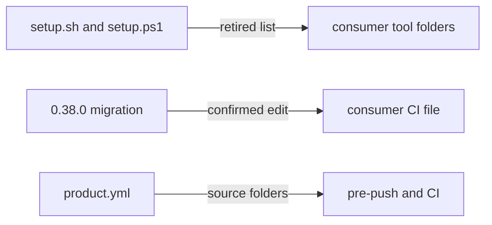

# Execution Plan - retire-fast-path

> Every requirement must be traceable to a user story or acceptance criterion.

**Skill:** [spec-agent](../../ravintio-framework/skills/ravintio-spec-agent/SKILL.md)
**Feature:** 0000040-retire-fast-path
**Version:** 0.38.0
**Status:** active

## Active Skills

| Skill | Scope | Purpose |
|-------|-------|---------|
| None | | The design declares no active skills. |

## Functional Requirements Directory

Functional requirements are split into individual files, one user story per file, at `plan/current/requirements/`.

| File | Requirement |
|------|------------|
| [req-001-one-track-routing.md](requirements/req-001-one-track-routing.md) | Every request routes to the Feature Pipeline, and triage stays only for the standalone skills (US-001). |
| [req-002-gates-ignore-scope-record.md](requirements/req-002-gates-ignore-scope-record.md) | `gate-write`, `shell-write-guard`, and `ratchet-check` stop reading `plan/.fast-path-scope`, and the gates stay in parity (US-002). |
| [req-003-no-commit-subject-exemption.md](requirements/req-003-no-commit-subject-exemption.md) | Pre-push and both CI files lose the `fix(fast-path):` exemption and gain the source folder rule (US-002). |
| [req-004-remove-track-files.md](requirements/req-004-remove-track-files.md) | The pack deletes both tracks' files, and setup removes installed copies through a retired list (US-003). |
| [req-005-consumer-migration.md](requirements/req-005-consumer-migration.md) | The 0.38.0 migration cleans a consumer repo, and migrator rule 1 widens for named paths (US-003). |
| [req-006-residue-guard.md](requirements/req-006-residue-guard.md) | A search suite fails on any live reference to either track outside its allowlist (US-001). |
| [req-007-docs-and-adr-supersede.md](requirements/req-007-docs-and-adr-supersede.md) | Docs show one track, five ADRs carry superseding notes, and the version reads 0.38.0 (US-001). |

## Build order

1. req-002 and req-004 land together, because two existing suites read `workflows/fast-path.md`.
2. req-001, req-003, and req-005 follow. req-005 quotes the exemption block that req-003 removes.
3. req-007's live-doc rewrites land in P3, after req-001 to req-005 and before req-006. The codegen agent writes them, so the guard scans a finished tree.
4. req-006 runs last in P3, over the finished tree.
5. At P6 the docs agent checks req-007's rewrites, adds the `component.yml` history comment, and adds the Feature 0000040 section to the decisions index. The decisions-index Status cells and superseding notes land in P3 with step 3, which replaces the earlier wording of this step. P7 sets `product.yml` and `docs/about.md`, as req-007's owner table states.

## File ownership

Each file has one owner requirement. Another requirement may state what a file must say, but only the owner's P3 step edits it.

| File or folder | Owner | Content it carries from other requirements |
|----------------|-------|--------------------------------------------|
| `ravintio-framework/skills/` (orchestrator, phase 0 references, ship, adr, optimise), `templates/standard-boot.md`, `templates/component-guide.md`, `templates/domain-glossary-guide.md`, `hooks/enforcement/auto-trigger-orchestrator.mjs` | req-001 | req-002's gate bullets in `standard-boot.md` |
| `hooks/enforcement/path-rules.mjs`, `gate-write.mjs`, `shell-write-guard.mjs`, `ratchet-check.mjs`, `.gitignore` | req-002 | none |
| `hooks/pre-push`, `hooks/ravintio.yml`, `.github/workflows/ravintio.yml` | req-003 | none |
| `setup.sh`, `setup.ps1`, deleted track files | req-004 | none |
| `skills/ravintio-migrator/SKILL.md`, the 0.38.0 migration | req-005 | none |
| the residue guard suite, and the brand guard allowlist rows | req-006 | req-004's deletion of `workflows/fast-path.md` |
| `README.md`, `getting-started.md`, `pipeline-reference.md`, `project-operations.md`, `tool-setup-reference.md`, every `docs/` file, every `src/setup-hook-integration/docs/` file, `component.yml`, `product.yml`, `docs/about.md` | req-007 | the routing text from req-001, the gate text from req-002, the CI text from req-003, and the installed-file listings from req-004 |

This table replaces the P1 ownership Decision line in the build log where the two differ.

## Non-Functional Requirements

| ID | Category | Requirement | Target | Measurement |
|----|----------|------------|--------|-------------|
| NFR-001 | Reliability | The test suite passes on every CI shard | 0 failures on the Linux, macOS, and Windows shards | CI on the PR |
| NFR-002 | Compliance | No live reference to either retired track | 0 unallowed matches | The req-006 residue guard |
| NFR-003 | Security | The write gates stay at least as strict | 0 cases that blocked before 0000040 and pass after it | The suites in req-002's "must stay green with no assertion changes" list, unchanged. Rewritten suites such as `test-0000035-req-003` keep every case that uses no scope record. |
| NFR-004 | Portability | Setup behaves the same on both shells | Same removals, output, and exit codes from `setup.sh` and `setup.ps1` | The req-004 parity suite |

## API Summary

Not applicable. The feature builds no API, so no OpenAPI specification exists.

## Data Model Summary

Not applicable. The feature owns no data store.

## Component Interactions

## Assumptions

Each is a risk item with likelihood: medium.

| ID | Assumption | Impact if Wrong |
|----|-----------|----------------|
| A-001 | No consumer depends on `FAST_PATH_ENFORCEMENT_PATHS` outside the pack. | A consumer script breaks on upgrade. |
| A-002 | No consumer run is mid-way through the Change Pipeline when it upgrades. | That run loses its skill and restarts on the Feature Pipeline. |

## Open Questions

| ID | Question | Blocking |
|----|----------|----------|
| Q-001 | Does `FAST_PATH_ENFORCEMENT_PATHS` survive under a new name? `isAlwaysPermitted` still reads it, and the residue guard matches the current name. | P2 decides. It blocks req-002 and req-006 at P3. |

P2 answer to Q-001: the list survives, renamed `ENFORCEMENT_PATHS`. ADR-004 records the decision and lists every reader that P3 renames.
