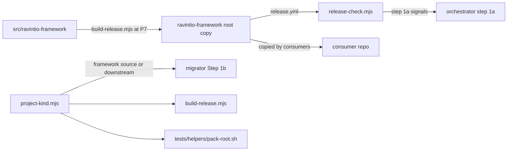

# Execution Plan - Pack source under src

> Every requirement must be traceable to a user story or acceptance criterion.

**Skill:** [spec-agent](../../ravintio-framework/skills/ravintio-spec-agent/SKILL.md)
**Feature:** 0000041-pack-source-under-src
**Version:** 0.39.0
**Status:** draft

## Active Skills

| Skill | Scope | Purpose |
|-------|-------|---------|
| none | plan | The design lists no capability skill. P3 uses the pipeline skills only. |

## Functional Requirements Directory

Functional requirements are split into individual files, one user story per file, at `plan/current/requirements/`.

| File | Story | Requirement |
|------|-------|------------|
| [req-001-move-pack-to-src.md](requirements/req-001-move-pack-to-src.md) | US-001 | One git pass moves the pack to `src/ravintio-framework/` and restores the root copy from `v0.38.0`. Edits then fix each source path. |
| [req-002-release-script.md](requirements/req-002-release-script.md) | US-002 | `build-release.mjs` rebuilds the root copy with `release.yml` and no `component.yml`. Hard Limit 8 and ship Step 5c name it. |
| [req-003-release-yml-readers.md](requirements/req-003-release-yml-readers.md) | US-002 | Step 1a, the update policy, and the migrator read `release.yml` first. `release-check.mjs` flags each changed file. |
| [req-004-component-path-rule.md](requirements/req-004-component-path-rule.md) | US-002 | One manifest-location rule. Codegen and ship read component paths and never name `ravintio-framework/component.yml`. |
| [req-005-applies-to-header.md](requirements/req-005-applies-to-header.md) | US-003 | `project-kind.mjs`, the `**Applies to:**` header, and the migrator's `not applicable` rule. |
| [req-006-consumer-migration.md](requirements/req-006-consumer-migration.md) | US-002 | The 0.39.0 migration offers one confirmed removal of a leftover `ravintio-framework/component.yml`. |
| [req-007-released-tree-version-suite.md](requirements/req-007-released-tree-version-suite.md) | US-001 | The 0000039 req-010 equality checks run only on a released tree. |
| [req-008-tests-and-ci-from-src.md](requirements/req-008-tests-and-ci-from-src.md) | US-001 | Suites read the pack through `tests/helpers/pack-root.sh`, CI runs from `src/`, and a CI job checks the root copy. |

Every story has a requirement. US-001 maps to req-001, req-007, and req-008. US-002 maps to req-002, req-003, req-004, and req-006. US-003 maps to req-005.

## Non-Functional Requirements

| ID | Category | Requirement | Target | Measurement |
|----|----------|------------|--------|-------------|
| NFR-001 | Performance | The release script builds the full pack | under 30 seconds for about 1,200 files | the timed case in `test-0000041-req-002-release-script.sh` (req-002 AC1) |
| NFR-002 | Integrity | Root copy files match `release.yml` | 100% of listed files match on every PR | the `release-copy-integrity` CI job running `release-check.mjs --files-only` (req-008) |
| NFR-003 | Security | The release script writes only inside the root copy and its two work folders | 0 bytes changed outside those three folders in every link fixture | the refusal cases in req-002 AC2 |
| NFR-004 | Reliability | Repeat runs change nothing | a second release build and a second migration run change 0 files | req-002 AC1 and req-006 AC2 |

## API Summary

Not applicable. The feature adds no API, so no `openapi-spec.yaml` exists.

## Data Model Summary

No database. The feature adds three file contracts.

| Entity | Owner Component | Key Fields | Relationships |
|--------|----------------|------------|--------------|
| `ravintio-framework/release.yml` | `ravintio-framework` (written only by `build-release.mjs`) | `format`, `version`, `source-commit`, `built`, `files` | read by `release-check.mjs`, the migrator, and the 0.39.0 migration |
| `plan/framework-release.yml` | the consuming project (written only by orchestrator step 1a) | `version`, `source-commit` | the recorded value that step 1a compares with `release.yml` |
| `plan/_migrations/{stem}.md` | the consuming project (written only by the migrator) | `migration`, `outcome`, `date`, counts | gains `not applicable` outcomes from the `**Applies to:**` rule |

## Component Interactions

## File ownership

Each file has one owner. Where a second requirement changes another section of the same file, the table names the section and the order. The second edit lands after the owner's TDD cycle is green.

| File | Owner | Also edited by (section, order) |
|------|-------|-------------------------------|
| the git pass commit (all of `src/ravintio-framework/`) | req-001 | none |
| `product.yml`, `.gitattributes`, `README.md`, `refresh-ravintio-framework-dir.ps1`, `docs/component-registry.md` | req-001 | none |
| `src/setup-hook-integration/component.yml` and `src/setup-hook-integration/docs/` | req-001 | none |
| `src/ravintio-framework/hooks/enforcement/em-dash-guard.mjs` | req-001 | none |
| `src/ravintio-framework/scripts/build-release.mjs` | req-002 | none |
| `src/ravintio-framework/templates/standard-boot.md`, `cursor-boot.md` | req-002 | none |
| `src/ravintio-framework/skills/ravintio-ship-agent/SKILL.md` | req-002 (Step 5c, Step 7 if-line, Prefix) | req-004 (Step 9 case 2 fallback), after req-002 |
| `src/ravintio-framework/scripts/release-check.mjs` | req-003 | none |
| `src/ravintio-framework/skills/ravintio-orchestrator/SKILL.md` | req-003 (steps 1a and 1b) | none |
| `src/ravintio-framework/standards/framework-update-policy.md` | req-003 | none |
| `src/ravintio-framework/skills/ravintio-migrator/SKILL.md` | req-005 (Step 1b, the header, the released-migrations table) | req-003 (the `framework-version` row, the Step 5 template, the version rule in Order and old paths), after req-005 |
| `src/ravintio-framework/templates/component-guide.md`, `skills/ravintio-spec-agent/SKILL.md`, `skills/ravintio-docs-agent/SKILL.md`, `skills/ravintio-codegen-agent/SKILL.md` | req-004 | none |
| `src/ravintio-framework/scripts/project-kind.mjs` | req-005 | none |
| `src/ravintio-framework/migrations/migrate-0.39.0-remove-pack-component-yml.md` | req-006 | none |
| `plan/_migrations/migrate-0.39.0-remove-pack-component-yml.md` | req-006 | none |
| `src/ravintio-framework/tests/test-0000039-req-010-version-bump.sh` | req-007 (content and resolver move) | none |
| `src/ravintio-framework/tests/helpers/pack-root.sh` | req-008 | none |
| `.github/workflows/ravintio.yml`, `scripts/self-description-check.mjs`, `tests/README.md`, `tests/run-tests.sh` usage comment | req-008 | none |
| every other existing suite under `src/ravintio-framework/tests/` and `tests/regression/` | req-008 (path edits) | req-002 (`test-0000035-req-008-sanctioned-scripts.sh` with its regression copy, and `test-0000039-req-008-emitted-names.sh`: the eighth script), after req-008 |
| each new `test-0000041-req-NNN-*.sh` suite | the requirement with that number | none |
| `src/ravintio-framework/component.yml` and `src/setup-hook-integration/component.yml` versions | P3 close-out | none |
| `docs/architecture-overview.md`, `docs/decisions-index.md` | P6 docs agent | none |

The root `ravintio-framework/` copy has no P3 owner. Only the git pass writes it at P3, and only `build-release.mjs` writes it at P7.

## Build order

P3 runs the requirements in this order. Each step names what it waits for.

1. req-001 git pass and its AC1 checks. Every other step waits for it.
2. req-005 `project-kind.mjs`, under TDD with its AC1 cases. The resolver and the release script import it. Its suite finds the pack from its own folder until the resolver exists, as req-008 states.
3. req-008 resolver, static scan, and suite path edits, which close its AC1. Every new suite sources the resolver. req-008 AC2 and AC3 need `build-release.mjs` and `release-check.mjs`, so they close at step 5.
4. req-001 follow-up path fixes and its suite.
5. req-002, then req-003's script, orchestrator, and update policy edits. req-008 AC2 and AC3 then close, because the CI integrity job runs `release-check.mjs` on a copy that `build-release.mjs` builds.
6. req-004, the req-005 migrator rule, req-003's migrator edits, then req-006. req-003's migrator edits land after the req-005 rule, as the file ownership table states, and req-003 closes here. The req-005 suite moves onto the resolver here.
7. req-007.
8. The P3 close-out bumps the component versions.

Steps 6 and 7 share no file, so P3 may run them as parallel streams.

## Assumptions

Each is a risk item with likelihood: medium.

| ID | Assumption | Impact if Wrong |
|----|-----------|----------------|
| A-001 | No consumer reads `ravintio-framework/component.yml` outside the pack. | A consumer script loses its version source after it removes the file. |
| A-002 | Every suite that names `ravintio-framework/` can read the pack through one resolver. | P3 rewrites more suites by hand, which grows req-008. |

## Open Questions

None. In autonomous mode, each open choice became a Decision line in the P1 build-log block.
